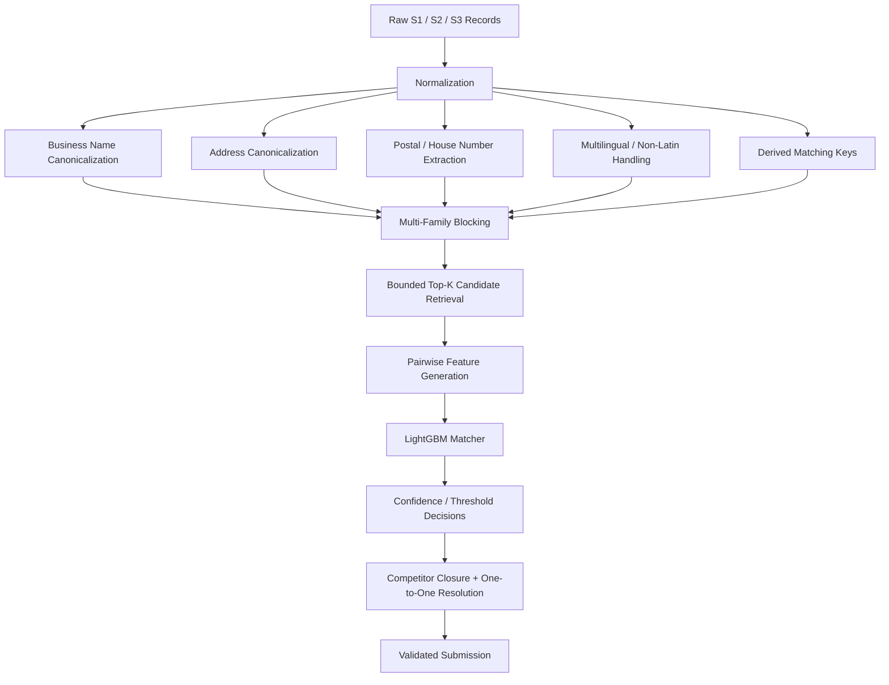

# Amazon ML Challenge 2026 — Business Entity Resolution

## Team Dhurandhar

A large-scale **business entity resolution** system built for the **Amazon ML Challenge 2026**.

The goal was to link noisy business records from multiple source datasets to a deduplicated reference dataset while maintaining high precision under a **macro-averaged F0.5** objective, where false merges are particularly costly.

**Final submitted leaderboard score: 0.934946**

---

## Project at a glance

| Metric                         |                             Result |
| ------------------------------ | ---------------------------------: |
| Test S1 reference entities     |                      **1,732,544** |
| Test S2 + S3 pool              |                      **9,969,589** |
| Candidate pairs generated      |                     **97,271,483** |
| Final submitted matches        |                      **5,495,717** |
| Peak observed inference memory |                       **~2.94 GB** |
| Validation macro F0.5          |                        **~0.9462** |
| Core matcher                   |                       **LightGBM** |
| Hardware target                | **8 GB Apple Silicon MacBook Air** |

The final inference pipeline handled the full test set on a memory-constrained laptop rather than relying on a large external compute environment.

---

# 1. Problem

The challenge provides three sources of business records:

* **S1** — reference / deduplicated entities
* **S2** — noisy business records
* **S3** — noisy business records

Each record contains:

```text
entity_id
business_name
business_address
country
```

The task is to determine which S2/S3 records refer to each S1 entity.

The noise is realistic and heterogeneous:

* spelling and typographical errors
* abbreviations
* legal suffixes
* punctuation differences
* token reordering
* DBA-like name variations
* missing address components
* address abbreviations
* transliteration
* landmarks and alternate address descriptions
* multilingual and non-Latin business names
* inconsistent postal and house-number representations

The final predictions must contain only valid S2/S3 IDs, and false merges are expensive under the competition's F0.5 metric.

---

# 2. System architecture



The pipeline is intentionally modular:

```text
normalize.py
    ↓
blocking.py
    ↓
features.py
    ↓
model.py
    ↓
decide.py
    ↓
pipeline.py
```

---

# 3. Core approach

## 3.1 Normalization

A major part of the problem is that apparently different strings can represent the same business.

The pipeline creates multiple normalized representations for names and addresses rather than relying on one aggressive canonical form.

Examples of derived information include:

```text
name_clean
name_core
name_key
name_nonlatin

addr_canon
addr_canon2
postal
postal2
house
house2
addr_nums
addr_cids
```

This makes the downstream matcher less dependent on any single normalization rule.

---

## 3.2 Multi-family blocking

Comparing every S1 against the complete S2/S3 pool would require an impractical number of pairwise comparisons.

Instead, the system generates candidates using multiple complementary key families.

The v2 blocker substantially improved candidate recall over the earlier v1 design.

### Blocking experiment

| Blocking configuration | Pair recall | Entity-level ceiling |
| ---------------------- | ----------: | -------------------: |
| v1, top-k 40           |      0.8702 |               0.9466 |
| v1, top-k 60           |      0.8908 |               0.9538 |
| v1, top-k 80           |      0.9000 |               0.9590 |
| v2, top-k 40           |      0.9374 |               0.9798 |
| **v2, top-k 60**       |  **0.9470** |           **0.9832** |

The final configuration used bounded candidate retrieval with multiple key families and `top-k=60`.

---

# 4. Pairwise matching

After blocking, candidate pairs are scored using structured pairwise features.

The feature set combines:

* name similarity
* address similarity
* exact-key agreement
* postal agreement
* house-number agreement
* country agreement
* token-level relationships
* missingness indicators
* multilingual / script-related signals
* derived address relationships

The matcher is a **LightGBM** model trained on positive and negative entity pairs.

---

# 5. Decision layer

The LightGBM probability is not used directly as the final answer.

A separate decision layer applies:

* probability thresholds
* source-specific decision logic
* relative confidence checks
* competitor resolution
* one-to-one constraints

The one-to-one structure of the training ground truth was also explicitly audited before being used as a resolution constraint.

This reduced duplicate ownership and improved precision on multi-match cases.

---

# 6. Experimentation

The system was developed through a sequence of controlled experiments rather than a single model run.

### Validation progression

| Experiment                           | Macro F0.5 |
| ------------------------------------ | ---------: |
| Baseline                             |     0.8962 |
| v1 keys + v1 features                |     0.9038 |
| v2 keys + v1 features                |     0.9266 |
| v2 keys + v2 features                |     0.9381 |
| v2 + competitor / one-to-one closure |     0.9425 |
| **Final tuned validation**           | **0.9462** |

The final validation configuration achieved:

```text
blocking ceiling F0.5   ≈ 0.9823
blocking pair recall    ≈ 0.9495
micro precision         ≈ 0.9836
micro recall            ≈ 0.8903
singleton accuracy      ≈ 0.9595
multi-match F0.5        ≈ 0.9499
```

---

# 7. Memory-constrained engineering

One of the most interesting engineering constraints was the hardware.

The target environment was an:

**8 GB Apple Silicon MacBook Air**

An earlier sparse TF-IDF blocking design exceeded the available memory budget during realistic runs.

The final pipeline was redesigned around:

* compact cached representations
* hashed blocking keys
* bounded posting lists
* maximum document-frequency controls
* top-k candidate limits
* streaming inference
* explicit garbage collection
* resumable inference
* avoiding unnecessary full-data materialization

### Full test inference

The complete test set contained:

```text
S1:        1,732,544
S2 + S3:  9,969,589
Pairs:    97,271,483
```

The final inference completed with approximately:

```text
Peak RSS: ~2.94 GB
```

This was an important design target: **scale the algorithm down to the hardware, rather than scaling the hardware up to the algorithm.**

---

# 8. Error analysis

The project includes an explicit error taxonomy rather than treating all mistakes as equivalent.

Major observed failure categories included:

| Error category                            |             Impact observed |
| ----------------------------------------- | --------------------------: |
| Multi-match misses                        | Largest source of F0.5 loss |
| Threshold false negatives                 |                 Significant |
| Address-number conflicts                  |                 Significant |
| Blocking misses                           |                 Significant |
| Name typos / variants                     |                 Significant |
| Cross-script / non-Latin names            |                 Significant |
| Missing addresses                         |                    Moderate |
| DBA-like name differences                 |                    Moderate |
| Legal-token position                      |                    Moderate |
| Same-name / different-business collisions |              Precision risk |

This analysis informed subsequent blocking, feature, and decision experiments.

---

# 9. Robustness testing

The model was tested beyond the primary validation split, including perturbation and cross-country scenarios.

Examples included:

* additional name/address noise
* salt-and-variation tests
* US → India transfer
* India → US transfer

These experiments highlighted an important limitation of entity-resolution systems:

> **Candidate generation and feature quality can remain strong while cross-domain distribution shifts still degrade final matching quality.**

That finding influenced the decision to favor conservative matching behavior under the competition's precision-sensitive metric.

---

# 10. Reproducibility

The repository contains the reusable source code, tests, experiment scripts, validation tooling, and supporting documentation.

Main project:

```text
code/business_entity_resolution/
├── src/ber/
│   ├── blocking.py
│   ├── blocking_v1_compact.py
│   ├── check_output.py
│   ├── decide.py
│   ├── errors.py
│   ├── features.py
│   ├── io.py
│   ├── metric.py
│   ├── model.py
│   ├── normalize.py
│   ├── pipeline.py
│   └── synth.py
│
├── tests/
├── tools/
├── experiments_8gb.sh
├── run_all.sh
└── requirements.txt
```

The pipeline wrapper supports the major stages:

```text
env
upgrade
sweep
sweep-ablation
train
robustness
final
rehearsal
infer
package
```

Typical usage:

```bash
cd code/business_entity_resolution

bash experiments_8gb.sh sweep <DATA_DIR> <WORK_DIR>

bash experiments_8gb.sh train <DATA_DIR> <WORK_DIR>

bash experiments_8gb.sh final <DATA_DIR> <WORK_DIR>

bash experiments_8gb.sh infer <DATA_DIR> <WORK_DIR>
```

---

# 11. Submission artifacts

The complete competition artifacts are preserved in the **v1.0.0 GitHub Release**.

### Release contents

* `dataset.zip` — competition dataset
* `Dhurandhar_submission.zip` — complete final submission package

[View the v1.0.0 release](../../releases/tag/v1.0.0)

Large artifacts are kept as Release assets instead of Git objects.

---

# 12. Validation

The final submission was checked with the competition's official validator.

The validator confirmed:

```text
Required S1 entities:    1,732,544
Valid S2/S3 IDs:         9,969,589
Matching rows:           1,732,544
Candidate rows:          1,732,544

PASS — no blocking issues found.
```

---

# 13. Tech stack

```text
Python 3.11
Pandas
NumPy
scikit-learn
LightGBM
PyArrow
pytest
Bash
```

---

# 14. What this project demonstrates

This project is less about a single model and more about the complete ML engineering workflow required for large-scale matching:

**problem decomposition → normalization → candidate generation → feature engineering → supervised ranking → decision logic → constraint resolution → error analysis → memory optimization → full-scale inference → submission validation**

The main lesson was that at millions of records, **candidate generation is as important as the classifier itself**.

A powerful matcher cannot recover a true pair that never reaches the candidate set.

---

# 15. Team

### Dhurandhar

Amazon ML Challenge 2026
Business Entity Resolution

Final submitted leaderboard score:

## **0.934946**
